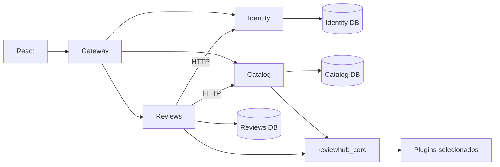
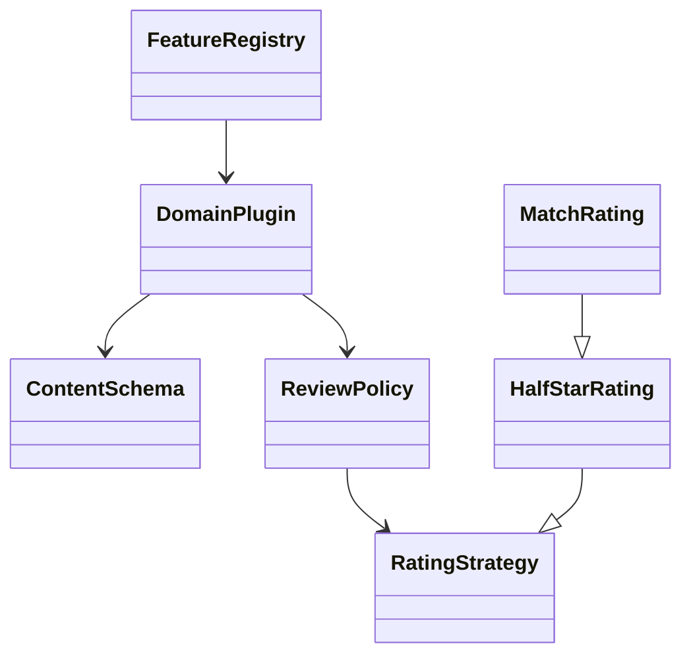
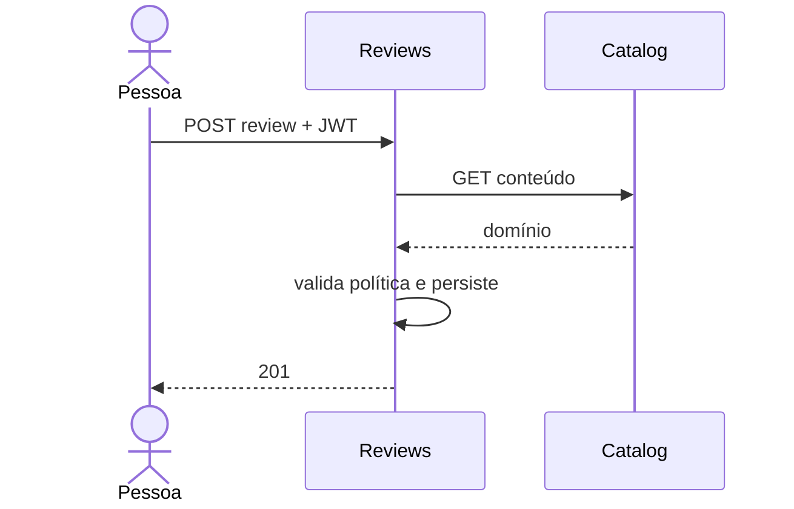
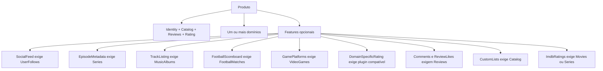

# Framework reutilizável e Linha de Produto

## Reuso de Software

O framework `reviewhub_core` resolve a validação e a composição de avaliações de diversos domínios sem duplicar controllers. Ele não é uma aplicação final: os três serviços o utilizam como biblioteca; os produtos selecionam seus componentes.

- **Pontos fixos:** validação de produto, registro, fluxo genérico de review, autenticação, persistência por serviço e política de nota padrão.
- **Pontos de extensão:** `DomainPlugin`, `ContentSchema`, `RatingStrategy`, `ReviewPolicy` e `ContentProvider`; plugins fornecem esquema, capacidades, regras e campos opcionais. `HalfStarRating` é a estratégia padrão; `MatchRating` especializa-a.
- **Padrões:** Strategy nas notas, Registry para plugins e Dependency Injection nas dependências FastAPI. Reuso ocorre por composição e por especialização das interfaces.
- O registro importa apenas os módulos dos domínios selecionados. Plugins externos são descobertos pelo grupo de entry points `reviewhub.domains`, sem editar o núcleo. Cada plugin deve ter identificador único, schema Pydantic e respeitar `DomainPlugin`.

Exemplo mínimo de pacote externo:

```toml
[project.entry-points."reviewhub.domains"]
books = "meu_pacote.books:Plugin"
```

```python
from reviewhub_core.plugins import ContentSchema, DomainPlugin


class Metadata(ContentSchema):
    author: str


class Plugin(DomainPlugin):
    identifier = "books"
    schema = Metadata
```

Instale o pacote no ambiente dos serviços e selecione `books` em um YAML de produto. O seed incluído só contempla os cinco domínios nativos. Os contratos genéricos de criação e avaliação continuam os mesmos; campos específicos opcionais podem ser ligados a features existentes por `feature_fields`. Novas features e suas restrições ainda exigem alterar o modelo de features.







## Linha de Produto de Software

A família cobre filmes, séries, videogames, partidas de futebol e álbuns. Identity, Catalog, Reviews e Rating são obrigatórias, assim como pelo menos um domínio. Comments, ReviewLikes, UserFollows, SocialFeed, SpoilerControl e as features de metadados e nota específica são opcionais. `custom_lists` habilita listas privadas de cada usuário e exige `catalog`.



| Feature/domínio | CineHub | MatchHub | Complete |
|---|---|---|---|
| Identity, Catalog, Reviews, Rating | sim | sim | sim |
| Movies, Series | sim | não | sim |
| FootballMatches | não | sim | sim |
| VideoGames, MusicAlbums | não | não | sim |
| Comments | sim | sim | sim |
| ImdbRatings (OMDb) | sim | não | sim |
| CustomLists | sim | não | sim |
| SpoilerControl | sim | não | sim |
| ReviewLikes, UserFollows, SocialFeed | não | não | sim |
| EpisodeMetadata | sim | não | sim |
| FootballScoreboard | não | sim | sim |
| TrackListing, GamePlatforms | não | não | sim |
| DomainSpecificRating | não | não | não |

A CLI valida dependências e gera manifesto JSON determinístico. Catalog rejeita domínios não selecionados, valida e filtra metadados opcionais; os serviços bloqueiam as operações das features desligadas. Review Service escolhe a política de avaliação por plugin. As mesmas configurações orientam a interface. O estado comum é o código e os bancos por serviço; os artefatos variáveis são manifesto, plugins carregados, regras e identidade visual. Não há restrições de exclusão além de identificadores duplicados ou desconhecidos.

| Requisito | Responsável | Teste ou evidência |
|---|---|---|
| Reuso das políticas | `reviewhub_core/plugins.py` | `test_plugins_share_review_policy_and_validate_metadata` |
| Extensão externa | entry points de `FeatureRegistry` | `test_external_domain_entrypoint` |
| Dependências | `reviewhub_core/features.py` | `test_invalid_feature_dependency` |
| Variantes de metadados e nota | plugins | `test_feature_metadata_and_specialized_rating` |
| Derivação distinta e determinística | CLI e YAMLs | `test_derivation_is_deterministic_and_distinct` |
| Autorização e bloqueio social | serviços | `test_social_features_and_disabled_routes` |
| Persistência e comunicação HTTP | três serviços | `scripts/postgres_smoke.py` com PostgreSQL |
| Interface condicionada | `src/Social.tsx` e `src/Lists.tsx` | Playwright e `Social.test.tsx` |
| Listas privadas | `services/catalog/main.py` | `test_custom_lists_ownership_and_feature_gate` e Playwright |

Os testes PostgreSQL executam Complete, MatchHub e CineHub com os mesmos processos e dados, verificando domínios e operações habilitadas. Os Playwright locais usam navegador Chromium real com serviços e PostgreSQL reais, por um proxy de teste; não substituem teste do Compose e do Nginx.

As organizações de [logbuster-api](https://github.com/logbuster-app/logbuster-api) e [hs-backend](https://github.com/HorizonteSeguro-PDS/hs-backend) foram consultadas como referência estrutural, sem cópia de código.
