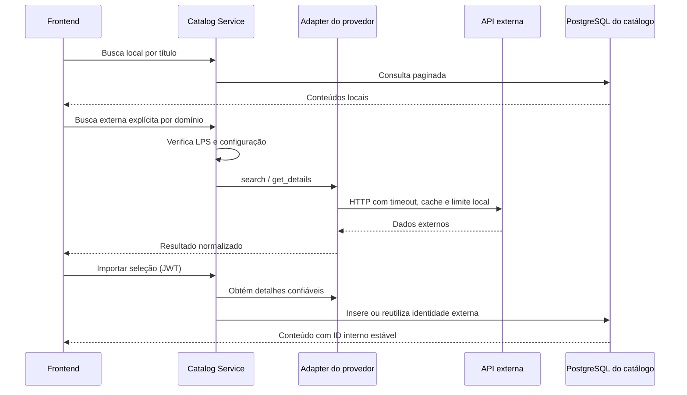

# Catálogo externo

O contrato `reviewhub_core.external.ExternalCatalogProvider` define busca, detalhes, normalização e imagens. Cada plugin de domínio declara o provedor correspondente; o registro do catálogo verifica tanto o domínio quanto a feature da instância antes de resolver o adapter. TMDB atende filmes e séries; IGDB, jogos; MusicBrainz, álbuns; football-data.org, partidas. Nenhuma credencial é enviada ao navegador.



A busca externa é uma ação separada da busca local e exige domínio habilitado. Para importar é necessário login; o servidor obtém novamente os detalhes, não confia nos campos fornecidos pelo cliente e verifica o schema do plugin. A identidade única é `(provedor, domínio, ID externo)`; o índice do banco e o tratamento de concorrência evitam duplicação. IDs internos, reviews e listas anteriores permanecem intactos. MusicBrainz usa **release group** como identidade do álbum e consulta uma release para obter faixas. A migration de catálogo é aditiva; seu downgrade remove as colunas externas e, portanto, perde os vínculos e metadados que elas contêm.

Endpoints: `GET /api/v1/external/search?domain=movies&q=...`, `GET /api/v1/external/{domain}/{external_id}` e `POST /api/v1/external/import` com `{"domain":"movies","external_id":"..."}`. O endpoint agregado `GET /api/v1/reviews/stats/batch?content_id=...&content_id=...` busca médias da comunidade em lote; pontuações de provedores não são importadas.

## Configuração

Copie `.env.example` para `.env`. Sem configuração os serviços iniciam normalmente e o catálogo local permanece disponível. No Compose as variáveis externas são entregues somente ao catálogo:

- `TMDB_API_TOKEN`: token de leitura de API; obtenha-o em [TMDB API](https://developer.themoviedb.org/docs/getting-started). O adapter usa `pt-BR` e obtém detalhes e créditos. A API impõe [atribuição e restrições de uso](https://developer.themoviedb.org/docs/faq); a interface exibe o aviso exigido e carrega um logotipo do TMDB. Confirme previamente as condições e o uso de logotipo aprovado para a distribuição pretendida.
- `IGDB_CLIENT_ID` e `IGDB_CLIENT_SECRET`: registre uma aplicação no [Twitch Developer Console](https://dev.twitch.tv/console), obtenha credenciais de aplicação e habilite o acesso à [IGDB](https://api-docs.igdb.com/). O token de aplicação é adquirido e renovado no backend. A documentação da IGDB restringe o uso gratuito a fins não comerciais; confira os termos antes de publicar.
- `MUSICBRAINZ_USER_AGENT`: identificação real com nome/versão e URL ou e-mail de contato, por exemplo `MinhaAplicacao/1.0 (contato: pessoa@exemplo.org)`. Não há chave, mas a identificação e o [limite de requisições](https://musicbrainz.org/doc/MusicBrainz_API/Rate_Limiting) são exigidos. Capas vêm do [Cover Art Archive](https://musicbrainz.org/doc/Cover_Art_Archive/API); verifique os direitos de cada imagem.
- `FOOTBALL_DATA_API_TOKEN`: obtenha chave em [football-data.org](https://www.football-data.org/). A busca considera partidas encerradas dos últimos 30 dias, e as competições e os dados efetivamente disponíveis dependem do plano e da chave. Consulte [cobertura](https://www.football-data.org/coverage), [planos](https://www.football-data.org/pricing) e termos aplicáveis. Não foi possível verificar as permissões de uma conta sem suas credenciais.

- `OMDB_API_KEY`: chave gratuita em [OMDb API](https://www.omdbapi.com/apikey.aspx) (plano gratuito com 1.000 requisições por dia). Alimenta a feature `imdb_ratings`. Veja a seção abaixo.

CineHub habilita `external_tmdb` e `imdb_ratings`; MatchHub, `external_football`; Complete habilita todos. Features de provedores exigem domínios compatíveis; domínios não selecionados são bloqueados no backend. O manifesto não contém credenciais. Após alterar `.env` ou produto, recrie/reinicie os serviços conforme o README.

## Notas do IMDb

O IMDb não oferece API pública gratuita (a oficial é paga, via AWS Data Exchange). A feature opcional `imdb_ratings` usa a OMDb, que expõe a nota e os votos do IMDb. Ela exige um domínio de filmes ou séries e não altera a busca nem a importação: apenas enriquece um conteúdo já existente no catálogo.

`GET /api/v1/contents/{id}/imdb` resolve o identificador IMDb assim:

1. Conteúdo importado do TMDB, com `TMDB_API_TOKEN` configurado: consulta `/{movie|tv}/{id}/external_ids` e usa o `imdb_id` (`matched_by: "imdb_id"`).
2. Caso contrário: busca na OMDb por título, tipo e ano (`matched_by: "title"`). Esse caminho pode associar uma obra homônima.

A resposta traz `rating` (0–10), `votes`, `metascore`, `rotten_tomatoes` e `url` do IMDb. Sem `OMDB_API_KEY` o endpoint retorna `{"configured": false}`; quando a obra não é encontrada, retorna `{"found": false}`. As notas não são gravadas no banco: ficam em cache por uma hora e são exibidas separadas da média da comunidade. As variantes locais sem APIs externas removem `imdb_ratings`. Confira os [termos da OMDb](https://www.omdbapi.com/legal.htm) e a política do IMDb antes de publicar.

### Catálogo de filmes via OMDb

`python -m services.catalog.seed_omdb` adiciona cerca de 100 filmes reais (clássicos, blockbusters, premiados recentes e brasileiros) com título, sinopse completa, pôster, direção, duração, elenco, gêneros e data de lançamento. O repositório guarda apenas a lista de IDs do IMDb (`MOVIE_IDS`); os dados vêm da OMDb a cada execução e não são versionados. Os filmes ficam com `external_provider="omdb"` e `external_id` igual ao ID do IMDb, de modo que a nota do IMDb é obtida pelo identificador exato. O comando é idempotente, requer `OMDB_API_KEY` e rede, consome uma requisição por filme novo e interrompe a execução diante de limite (429) ou chave inválida. Sinopses e títulos vêm em inglês, pois a OMDb não oferece outros idiomas. Pôsteres são servidos pelo IMDb/Amazon; verifique os direitos de uso antes de publicar.

```sh
mise run db:seed:omdb        # Compose em execução
mise run db:seed:omdb:local  # serviços nativos, lendo .env
```

### Partidas via football-data.org

`python -m services.catalog.seed_football` importa todas as partidas encerradas de competições inteiras, sem o limite de 30 dias da busca pela interface. Por padrão, carrega a Copa do Mundo 2026 (104 jogos) e o Brasileirão da temporada atual, com uma requisição por temporada. Para escolher outras, passe `CÓDIGO[:ANO]`, por exemplo `python -m services.catalog.seed_football BSA:2025 CLI CL`. O plano gratuito cobre WC, EC, CL, CLI, BSA, PL, ELC, PD, SA, BL1, FL1, DED e PPL. O comando é idempotente: repetido durante uma temporada em andamento, adiciona apenas os jogos novos. Requer `FOOTBALL_DATA_API_TOKEN` e respeita `football_scoreboard`: sem essa feature, os placares não são gravados.

Em jogos decididos nos pênaltis, o `fullTime` da API soma a disputa de pênaltis. O adapter subtrai os pênaltis do placar (Alemanha × Paraguai fica 1 × 1, não 4 × 5) e registra a disputa e a prorrogação na descrição. Nomes de seleções e clubes vêm como a API fornece, em geral em inglês.

```sh
mise run db:seed:football        # Compose em execução
mise run db:seed:football:local  # serviços nativos, lendo .env
```

### Álbuns via MusicBrainz

`python -m services.catalog.seed_music` adiciona cerca de 100 álbuns reais: clássicos do rock, soul e jazz, hip-hop, pop recente e MPB (Elis & Tom, Clube da Esquina, Acabou Chorare, Sobrevivendo no Inferno, AmarElo e outros). O repositório guarda apenas os IDs de release group; título, artista, gêneros, data e faixas vêm do MusicBrainz, e as capas do Cover Art Archive. A execução faz duas requisições por álbum com intervalo mínimo de 1,1 s (cerca de 4 minutos no melhor caso; numa execução real, com o MusicBrainz limitando o ritmo, levou 57 minutos), repete até três vezes quando o MusicBrainz responde 503 por excesso de ritmo e grava o progresso a cada álbum. É idempotente, não exige chave e requer `MUSICBRAINZ_USER_AGENT` com URL ou e-mail de contato. Faixas só são gravadas quando `track_listing` está habilitada.

```sh
mise run db:seed:music        # Compose em execução
mise run db:seed:music:local  # serviços nativos, lendo .env
```

### Games via IGDB

`python -m services.catalog.seed_games` adiciona cerca de 100 games reais, de Super Mario Bros. (1985) a Clair Obscur: Expedition 33 (2025), com resumo, capa, plataformas, gêneros e desenvolvedora. O repositório guarda apenas os IDs da IGDB; os dados são buscados em lotes de até 100 jogos por requisição (a lista completa leva poucos segundos). Os IDs foram conferidos manualmente, porque a busca por nome costuma retornar DLCs, pacotes ou versões antigas (por exemplo, o Resident Evil 2 de 1998 em vez do remake de 2019). É idempotente, requer `IGDB_CLIENT_ID` e `IGDB_CLIENT_SECRET` e só grava plataformas quando `game_platforms` está habilitada. Resumos vêm em inglês.

```sh
mise run db:seed:games        # Compose em execução
mise run db:seed:games:local  # serviços nativos, lendo .env
```

## Resiliência e limites

Respostas são armazenadas em memória por processo, por até 10 minutos (TMDB/IGDB), uma hora (OMDb), 15 minutos (futebol) ou uma hora (MusicBrainz), com limite de entradas. Falhas não são armazenadas. Há timeout de quatro segundos por chamada, mensagens sem credenciais e tratamento de timeout, autenticação, 404, 429 e indisponibilidade. O acesso é serializado e espaçado por provedor; MusicBrainz usa intervalo mínimo de 1,1 s. **Esses limites e caches não são compartilhados entre processos, réplicas ou aplicações no mesmo IP**: implantações com múltiplos workers precisam de coordenação central antes do uso real. Conteúdos locais já importados continuam disponíveis mesmo sem o provedor.

Para testes simulados execute `uv run pytest`; para testes opcionais de rede configure as credenciais e/ou o User-Agent real e execute `RUN_EXTERNAL_INTEGRATION=1 uv run pytest tests/test_external_live.py`. Isso realiza requisições reais; provedores sem configuração são ignorados. A disponibilidade e os direitos de uso de dados e imagens devem ser verificados para cada implantação.
