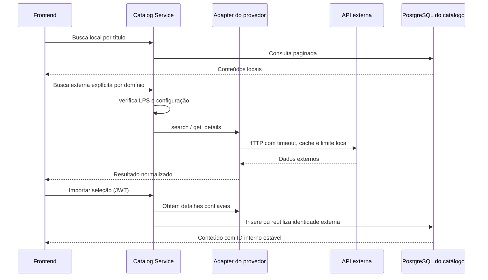

# Catálogo externo

O contrato `reviewhub_core.external.ExternalCatalogProvider` define busca, detalhes, normalização e imagens. Cada plugin de domínio declara o provedor correspondente; o registro do catálogo verifica tanto o domínio quanto a feature da instância antes de resolver o adapter. TMDB atende filmes e séries; IGDB, jogos; MusicBrainz, álbuns; football-data.org, partidas. Nenhuma credencial é enviada ao navegador.

A busca externa é uma ação separada da busca local e exige domínio habilitado. Para importar é necessário login; o servidor obtém novamente os detalhes, não confia nos campos fornecidos pelo cliente e verifica o schema do plugin. A identidade única é `(provedor, domínio, ID externo)`; o índice do banco e o tratamento de concorrência evitam duplicação. IDs internos, reviews e listas anteriores permanecem intactos. MusicBrainz usa **release group** como identidade do álbum e consulta uma release para obter faixas. A migration de catálogo é aditiva; seu downgrade remove as colunas externas e, portanto, perde os vínculos e metadados que elas contêm.

Endpoints: `GET /api/v1/external/search?domain=movies&q=...`, `GET /api/v1/external/{domain}/{external_id}` e `POST /api/v1/external/import` com `{"domain":"movies","external_id":"..."}`. O endpoint agregado `GET /api/v1/reviews/stats/batch?content_id=...&content_id=...` busca médias da comunidade em lote; pontuações de provedores não são importadas.

## Configuração

Copie `.env.example` para `.env`. Sem configuração os serviços iniciam normalmente e o catálogo local permanece disponível. No Compose as variáveis externas são entregues somente ao catálogo:

- `TMDB_API_TOKEN`: token de leitura de API; obtenha-o em [TMDB API](https://developer.themoviedb.org/docs/getting-started). O adapter usa `pt-BR` e obtém detalhes e créditos. A API impõe [atribuição e restrições de uso](https://developer.themoviedb.org/docs/faq); a interface exibe o aviso exigido e carrega um logotipo do TMDB. Confirme previamente as condições e o uso de logotipo aprovado para a distribuição pretendida.
- `IGDB_CLIENT_ID` e `IGDB_CLIENT_SECRET`: registre uma aplicação no [Twitch Developer Console](https://dev.twitch.tv/console), obtenha credenciais de aplicação e habilite o acesso à [IGDB](https://api-docs.igdb.com/). O token de aplicação é adquirido e renovado no backend. A documentação da IGDB restringe o uso gratuito a fins não comerciais; confira os termos antes de publicar.
- `MUSICBRAINZ_USER_AGENT`: identificação real com nome/versão e URL ou e-mail de contato, por exemplo `MinhaAplicacao/1.0 (contato: pessoa@exemplo.org)`. Não há chave, mas a identificação e o [limite de requisições](https://musicbrainz.org/doc/MusicBrainz_API/Rate_Limiting) são exigidos. Capas vêm do [Cover Art Archive](https://musicbrainz.org/doc/Cover_Art_Archive/API); verifique os direitos de cada imagem.
- `FOOTBALL_DATA_API_TOKEN`: obtenha chave em [football-data.org](https://www.football-data.org/). A busca considera partidas encerradas dos últimos 30 dias, e as competições e os dados efetivamente disponíveis dependem do plano e da chave. Consulte [cobertura](https://www.football-data.org/coverage), [planos](https://www.football-data.org/pricing) e termos aplicáveis. Não foi possível verificar as permissões de uma conta sem suas credenciais.

CineHub habilita `external_tmdb`; MatchHub, `external_football`; Complete habilita todos. Features de provedores exigem domínios compatíveis; domínios não selecionados são bloqueados no backend. O manifesto não contém credenciais. Após alterar `.env` ou produto, recrie/reinicie os serviços conforme o README.

## Resiliência e limites

Respostas são armazenadas em memória por processo, por até 10 minutos (TMDB/IGDB), 15 minutos (futebol) ou uma hora (MusicBrainz), com limite de entradas. Falhas não são armazenadas. Há timeout de quatro segundos por chamada, mensagens sem credenciais e tratamento de timeout, autenticação, 404, 429 e indisponibilidade. O acesso é serializado e espaçado por provedor; MusicBrainz usa intervalo mínimo de 1,1 s. **Esses limites e caches não são compartilhados entre processos, réplicas ou aplicações no mesmo IP**: implantações com múltiplos workers precisam de coordenação central antes do uso real. Conteúdos locais já importados continuam disponíveis mesmo sem o provedor.

Para testes simulados execute `uv run pytest`; para testes opcionais de rede configure as credenciais e/ou o User-Agent real e execute `RUN_EXTERNAL_INTEGRATION=1 uv run pytest tests/test_external_live.py`. Isso realiza requisições reais; provedores sem configuração são ignorados. A disponibilidade e os direitos de uso de dados e imagens devem ser verificados para cada implantação.
